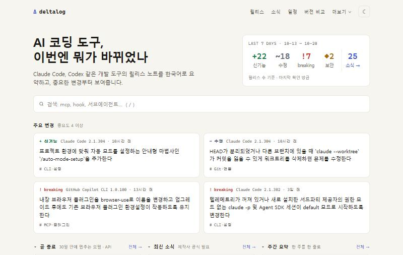
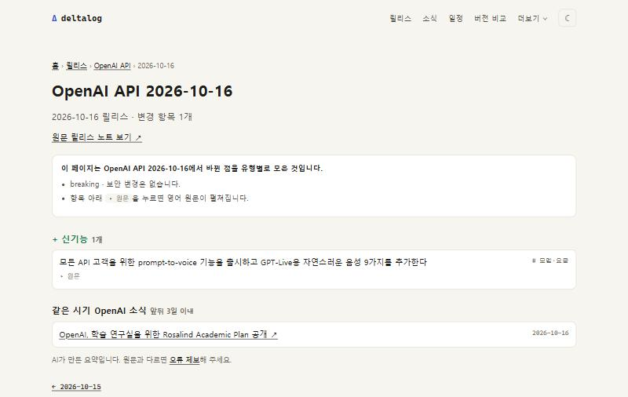
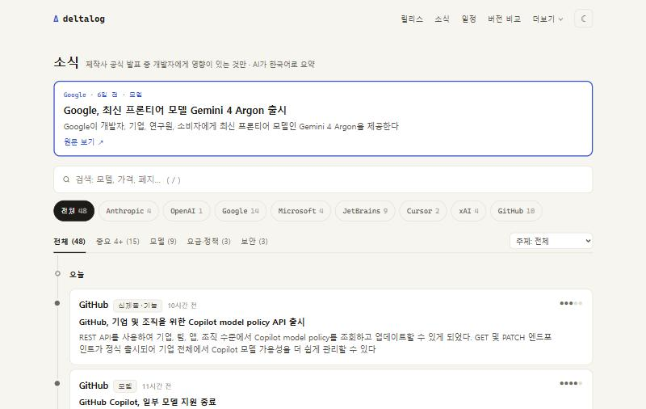
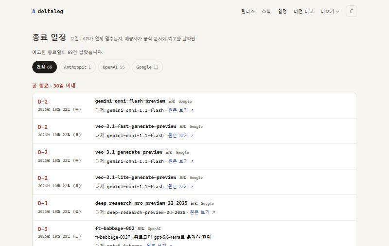
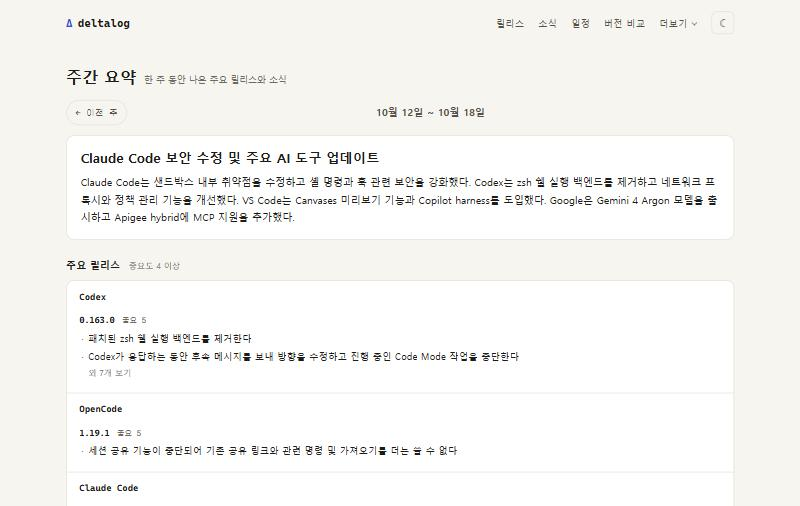
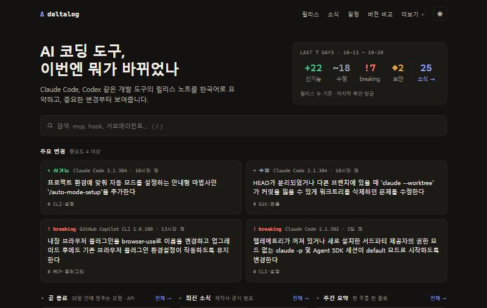
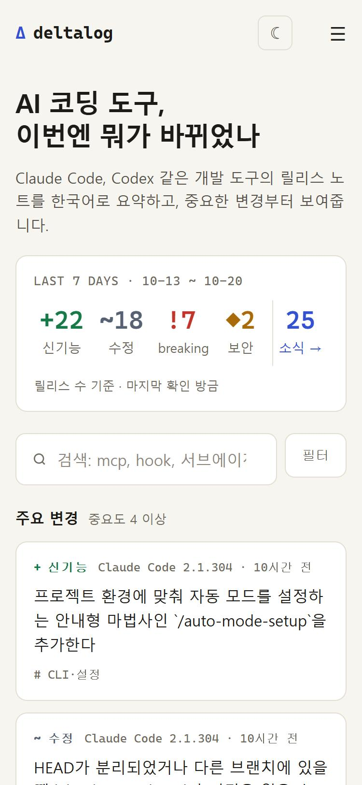
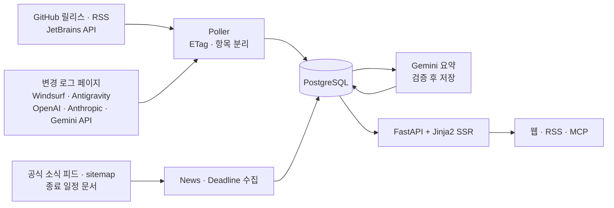

<div align="center">

# Deltalog

**AI 코딩 도구 릴리스 노트를 한국어로 요약해 한곳에 모아 보여주는 서비스**

Claude Code, Codex, Gemini CLI, Cursor, VS Code, JetBrains IDE의 새 버전에서 무엇이 바뀌었는지, 중요한 변경부터 한국어로 확인합니다.

[**deltalog.kr**](https://deltalog.kr)




</div>

<br>

## 프로젝트 소개

Claude Code는 거의 매일 새 버전이 나오고, Codex · Cursor · VS Code · JetBrains IDE도 릴리스마다 변경 항목이 수십 개씩 붙습니다. 영어 원문을 일일이 읽지 않고도 **내가 쓰는 도구가 이번에 무엇이 바뀌었는지**, 특히 **breaking change와 보안 수정**을 놓치지 않게 하는 것이 목적입니다.

- 릴리스 노트를 항목 단위로 나눠 한국어 한 줄로 요약하고, 유형(신기능 · 수정 · breaking · 보안), 중요도(1~5), 주제로 분류합니다.
- 제작사(Anthropic, OpenAI, Google 등)의 공식 소식, 모델 · API 종료 일정도 같이 모읍니다.
- 모든 요약에는 영어 원문 토글과 오류 제보 링크가 있고, 원문에 없는 영어 단어나 일본어 · 한자가 섞인 요약은 저장하지 않고 다시 요약합니다.

<br>

## 추적하는 소스

릴리스 소스 25곳을 30분마다 확인합니다.

| 구분 | 도구 |
|---|---|
| AI 에이전트 CLI | Claude Code, Codex, Gemini CLI, GitHub Copilot CLI, OpenCode, Cline, Qwen Code, Goose, Kilo Code, Antigravity CLI, Antigravity SDK |
| AI 에디터 · IDE | VS Code, Cursor, Kiro, Zed, Windsurf (Devin Desktop), Antigravity, Antigravity IDE, Android Studio, IntelliJ IDEA, PyCharm, WebStorm |
| 모델 · API 변경 로그 | Anthropic API, OpenAI API, Gemini API |

공식 소식은 Anthropic, OpenAI, Google, Microsoft, JetBrains, Cursor, xAI, GitHub 8곳에서 60분마다, 모델 · API 종료 일정은 Anthropic · OpenAI · Google 공식 문서 3곳에서 6시간마다 가져옵니다.

<br>

## 화면 구성

### 홈 · 릴리스 상세

<table>
  <tr>
    <td width="50%"></td>
    <td width="50%"></td>
  </tr>
  <tr>
    <td align="center">최근 7일 박스, 주요 변경 카드, 입력 즉시 검색</td>
    <td align="center">릴리스별 유형 · 중요도 · 주제, 같은 시기 제작사 소식</td>
  </tr>
</table>

### 소식 · 종료 일정 · 주간 요약

<table>
  <tr>
    <td width="33%"></td>
    <td width="33%"></td>
    <td width="33%"></td>
  </tr>
  <tr>
    <td align="center">제작사 공식 발표 중 개발자에게 영향이 있는 것만</td>
    <td align="center">D-day와 대체 모델까지 날짜순</td>
    <td align="center">한 주의 릴리스와 소식을 한 줄로</td>
  </tr>
</table>

### 테마 · 모바일

<table>
  <tr>
    <td width="66%"></td>
    <td width="34%"></td>
  </tr>
  <tr>
    <td align="center">밝은 / 어두운 테마</td>
    <td align="center">모바일 반응형</td>
  </tr>
</table>

<br>

## 주요 기능

- **한국어 요약 · 분류** — 릴리스 항목마다 한 줄 요약, 유형 · 중요도 · 주제(에이전트, MCP · 플러그인, 훅, 보안 · 권한, 모델 · 요금 등 13개)를 붙입니다.
- **버전 비교** (`/changes`) — 지금 쓰는 버전을 넣으면 그 뒤 최신 버전까지 바뀐 점을 중요한 것부터 모아 보여줍니다.
- **종료 일정** (`/deadlines`) — 모델 · API 종료일, D-day, 대체 모델을 공식 문서에서 뽑아 보여주고 홈에 곧 멈추는 것을 띄웁니다.
- **주간 요약** (`/weekly`) — 한 주의 릴리스를 도구별로 묶고 제목과 요약을 만듭니다.
- **검색 · 필터** — 입력 즉시 검색, 도구 · 유형 · 주제 · 중요도 필터, 도구별 최신 버전 한눈에 보기.
- **RSS** (`/feed.xml`) — 도구 · 제작사 · 최소 중요도를 골라 나만의 구독 주소를 만듭니다 (`/subscribe`).
- **MCP 서버** (`/mcp`) — Claude Code, Cursor, VS Code, Gemini CLI 같은 AI 에이전트가 릴리스 요약 · 종료 일정 · 소식을 직접 조회합니다 (`/agents`).
- **수집 현황** (`/status`) — 소스별 마지막 확인 시각과 수집 성공 여부를 공개합니다.
- **SEO** — 페이지별 title · description · canonical · Open Graph · JSON-LD, 릴리스 상세 페이지 약 300개, `sitemap.xml` · `robots.txt`.

<br>

## 기술 스택

| 구분 | 사용 기술 |
|---|---|
| Backend | Python, FastAPI, SQLAlchemy, APScheduler, httpx |
| Frontend | Jinja2 SSR, 바닐라 JavaScript, CSS |
| Database | PostgreSQL |
| AI | Gemini API (OpenAI 호환 엔드포인트) |
| Infra | Docker, Cloudflare |

<br>

## 아키텍처



### 요약 파이프라인

1. 릴리스 본문을 항목(최상위 `-` 한 줄) 단위로 나눕니다.
2. Gemini가 항목마다 한국어 한 줄 요약, 유형, 중요도, 주제를 JSON으로 돌려줍니다.
3. 검증을 통과한 것만 저장합니다: 길이, 종결 어미, 번호 누락, **원문에 없는 영어 단어 · 일본어 가나 · 한자**.
4. 실패한 항목은 이유를 남기고 다음 주기에 다시 요약합니다. 프롬프트 버전이 바뀌면 이전 요약을 자동으로 다시 만듭니다.

<br>

## 폴더 구조

```
api/          라우터 (pages · 릴리스 · 항목 · MCP)
core/         설정, 상수(소스 · 소식 · 종료 일정), 미들웨어, 로거
crud/         DB 조회와 저장
db/           세션, 초기화
models/       SQLAlchemy 모델
services/
  collector/  소스별 수집 (GitHub · RSS · JetBrains · 변경 로그 페이지), 항목 분리, 수집 현황
  llm/        Gemini 호출과 요약 검증 (릴리스 · 소식 · 종료 일정 · 주간)
  web/        화면용 데이터 (홈 · 릴리스 · 소식 · 종료 일정 · 주간 · 버전 비교 · sitemap)
templates/    Jinja2 템플릿
static/       CSS · JS · 이미지
```

<br>

## 요약 정확도

요약은 AI(Gemini)가 만들며 틀릴 수 있습니다. 항목마다 영어 원문을 펼쳐 볼 수 있고, 오류 제보 링크로 알려 주세요. 최종 판단은 항상 원문을 기준으로 합니다.

<br>

## 개발자

| | |
|---|---|
|  | **Hasegos**<br>기획 · 설계 · 개발 · 배포 · 운영 전체<br>[GitHub](https://github.com/Hasegos) |

<br>

## 저작권

© 2026 Deltalog. All rights reserved.

이 저장소의 소스 코드는 저작권자의 허락 없이 복제 · 배포 · 상업적 이용을 할 수 없습니다. 각 도구의 릴리스 노트 원문은 해당 제작사에 저작권이 있으며, Deltalog는 요약과 원문 링크만 제공합니다.